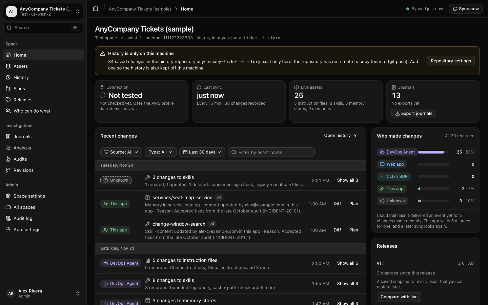
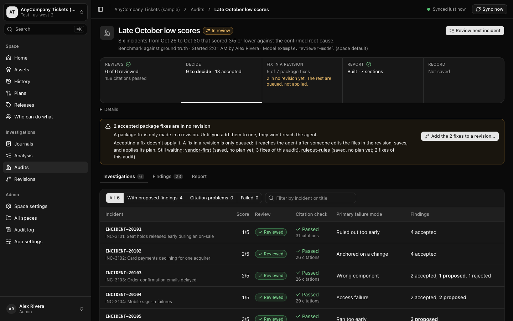
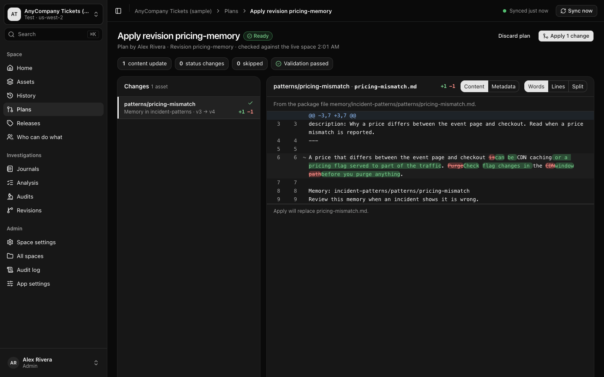
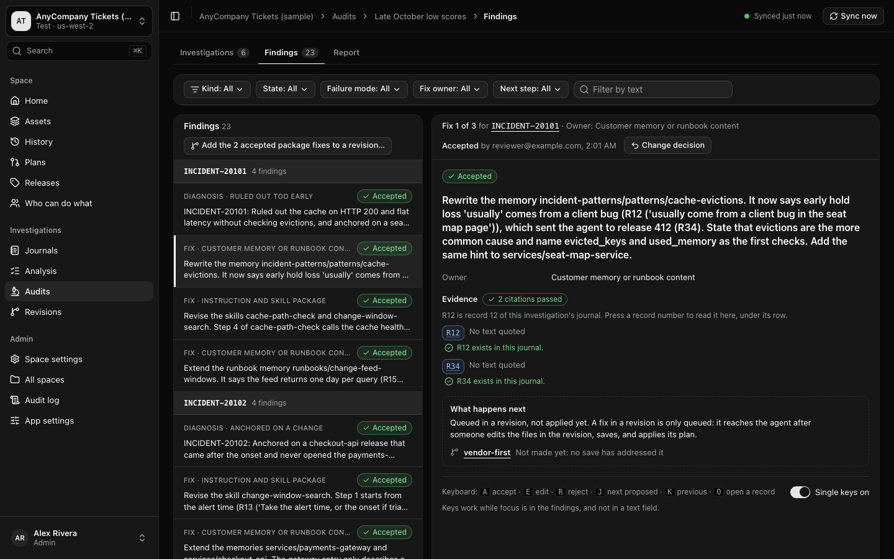
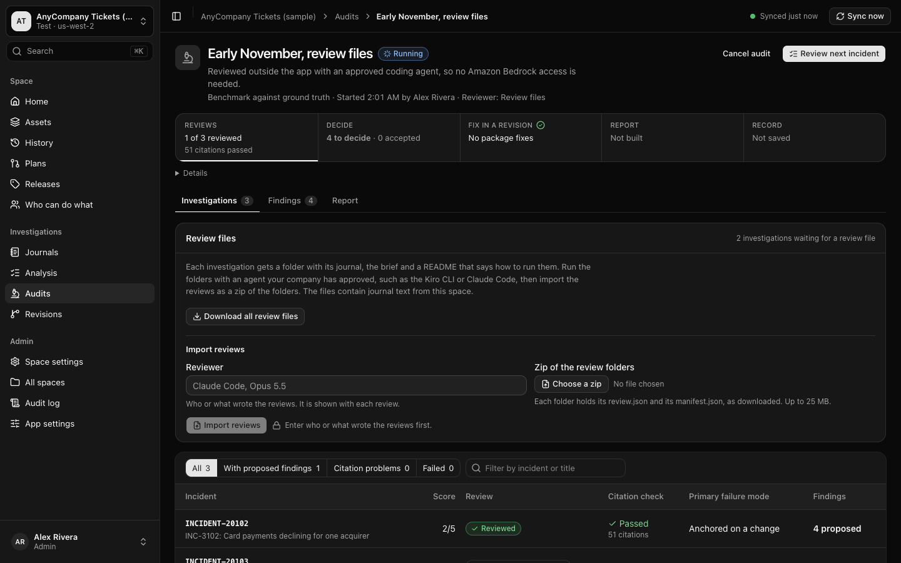
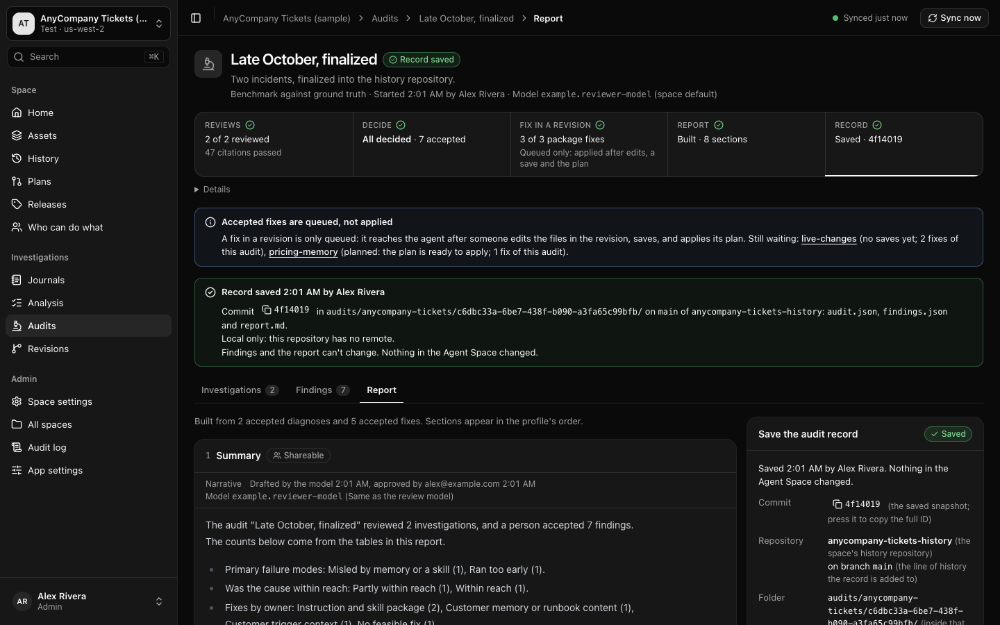
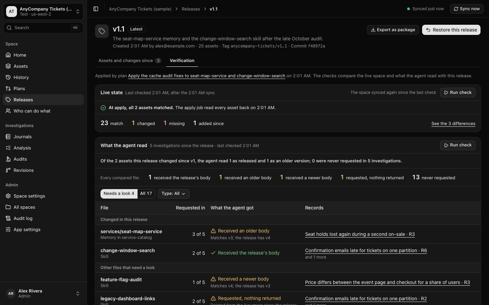
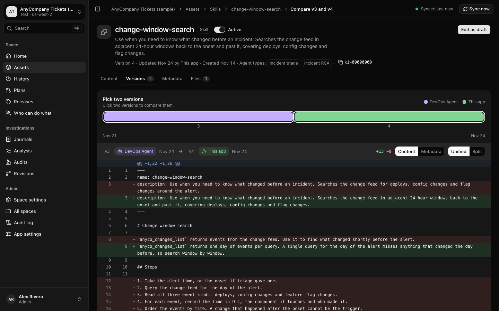

# DevOps Agent Manager

A web app that manages an [AWS DevOps Agent Space](https://docs.aws.amazon.com/devopsagent/latest/userguide/about-aws-devops-agent-what-are-devops-agent-spaces.html) from outside the console: a git history of its instructions, skills and memory, reviewed changes, restorable releases, and audits that turn investigations into tracked fixes.

> **A community project, not an official AWS product.** AWS does not support or endorse it. It is a stop-gap until the AWS DevOps Agent service offers these features itself.



The screenshots show the sample space, AnyCompany Tickets, which is invented, in the dark theme. Every screen in them is in the [demo](#try-it).

## What it does

- **History.** Every version of every asset goes into a git repository, with who made the change: the DevOps Agent, the Operator Web App, the CLI or SDK, or this app. A change this app applied carries the reason from its plan, and you can add a reason to any other change.
- **Plans.** Edit a draft or import a package, review the diff in a plan, then apply it. The app changes a space's assets only through a reviewed plan, and a space can require a second person to approve.
- **Releases.** Save a snapshot of every asset, restore it as a plan, and check afterwards that the live space matches it and which version of each file the agent read.
- **Journals.** Export investigation journals from the space, import them, and run analyzers on them.
- **Audits.** A reviewer compares investigations with a confirmed root cause: a model in Amazon Bedrock, a coding agent you run on review files, or a DevOps Agent chat. Audits with review files need no Bedrock access. You accept or reject each finding against the records it cites, send the fixes to a revision, and save the audit record to git.
- **Revisions.** Edit the instruction package on a branch, link each change to the findings behind it, then turn it into a plan and a release.

[Concepts](docs/concepts.md) explains each one with the app's own words.

## From an investigation to a verified fix

The parts connect, so a problem found in one investigation can be followed to the change that fixed it, and on to the runs that used that change:

1. **Review.** A reviewer reads the investigations and proposes findings, each citing journal records. The app checks every citation against the journal.
2. **Decide.** A person accepts, edits or rejects each finding. An accepted fix to a memory or an instruction is a package fix.
3. **Fix in a revision.** **Add to revision…** queues the fix on a revision. Someone edits the files, and each save links the findings it addresses.
4. **Plan and release.** The revision becomes a plan. When the plan is applied, the app tags a release.
5. **Verify.** The release's Verification tab shows whether the live space matches the release, and whether the agent read the new text in later investigations.

The strip at the top of each audit shows the steps and what is left at each. Here, 2 of the accepted fixes are in no revision yet, so the audit page says so:



Every change to the space goes through a plan like this one: the changes on the left, the diff of the selected change on the right, and Apply in the header.



## Try it

You need [Podman](https://podman.io/) (or Docker) and Git. The demo uses sample data and no AWS account.

```sh
./scripts/stack.sh demo
```

Open <http://127.0.0.1:3001>. You are signed in as Alex Rivera, the owner of the sample space. Run `./scripts/stack.sh demo --reset` to seed it again, and `./scripts/stack.sh down --demo` to stop it.

## Run it against your Agent Space

You need an AWS profile that can read the space, and the [AWS CLI](https://docs.aws.amazon.com/cli/latest/userguide/getting-started-install.html) (2.9.6 or later). [AWS setup](docs/aws-setup.md) lists the permissions.

```sh
./scripts/stack.sh up --profile <your-aws-profile>
```

The script signs you in to AWS when it needs to (a browser opens for IAM Identity Center, including with Okta), builds the image, and passes the profile's credentials to the containers. A background process renews them for as long as your AWS sign-in lasts. When the sign-in ends, `./scripts/stack.sh login` signs you in again. The first build needs a container engine with 3.5 GiB of memory.

Open <http://127.0.0.1:3000>, register your space, and run the first sync. [Getting started](docs/getting-started.md) walks through it and covers credentials in containers (including Okta tools), changing the policy, updates and where data lives.

Other commands: `./scripts/stack.sh status` (also shows the AWS credentials), `login`, `logs` and `down` (add `--volumes` to delete the database and history). Node 22+ and pnpm are only needed to develop the app: see [Development](docs/development.md).

## More screens

<table>
  <tr>
    <td width="50%"><a href="docs/images/findings.png"></a><br>The Findings tab: each finding with its cited records, and the revision it went to</td>
    <td width="50%"><a href="docs/images/revision-editor.png"></a><br>A revision, with the fixes sent from an audit under To address</td>
  </tr>
  <tr>
    <td width="50%"><a href="docs/images/review-files.png"></a><br>An audit reviewed with review files, which needs no Amazon Bedrock access</td>
    <td width="50%"><a href="docs/images/audit-record.png"></a><br>A saved audit record: the commit in the history repository, and the fixes still queued</td>
  </tr>
  <tr>
    <td width="50%"><a href="docs/images/release-verification.png"></a><br>Release verification: the live space, and which version of each file the agent read</td>
    <td width="50%"><a href="docs/images/asset-history.png"></a><br>An asset's version history and the difference between two versions</td>
  </tr>
</table>

## Documentation

| Page | Read it to |
|---|---|
| [Getting started](docs/getting-started.md) | Try the demo, run against your space, audit without Bedrock, stop, update |
| [AWS setup](docs/aws-setup.md) | Give the app the AWS permissions it needs |
| [Concepts](docs/concepts.md) | Understand history, plans, releases, verification, journals, audits and revisions |
| [Configuration](docs/configuration.md) | Look up an environment variable |
| [Policy](docs/policy.md) | Change rules, layouts, reviewers and audit prompts, for example for your own package |
| [Security](docs/security.md) | See how the app is protected and what it does not cover |
| [Troubleshooting](docs/troubleshooting.md) | Fix a stopped Podman machine, a database error, a policy error, a failed sync or a failed review |
| [Development](docs/development.md) | Run the app natively, run the tests, capture the screenshots, change the code |
| [Roadmap](docs/roadmap.md) | See what is planned, and what self-hosting needs before it is ready |

[`sample-data/`](sample-data/README.md) describes the invented dataset behind the demo and the tests.

## Security

The app listens on `127.0.0.1` by default. It changes an Agent Space's assets only through reviewed plans, and writes only in its worker process. The one other write is the two temporary files of a DevOps Agent chat review. Details are in [Security](docs/security.md). To report a vulnerability, follow [SECURITY.md](SECURITY.md).

## Upcoming

Today the app runs on one computer. Next on the [Roadmap](docs/roadmap.md):

- **Self-hosting** for a team, on a server with sign-in through your identity provider. The code has a hosted mode, but it is not ready for use: the roadmap lists [what has to be true first](docs/roadmap.md#self-hosting). Until then, run the app on your own computer.
- **A published container image** for each release, so the first start skips the build.
- **A tested Windows path** through WSL2.

## Contributing and license

Read [CONTRIBUTING.md](CONTRIBUTING.md) before you open a pull request. The project is released under the [MIT License](LICENSE).
