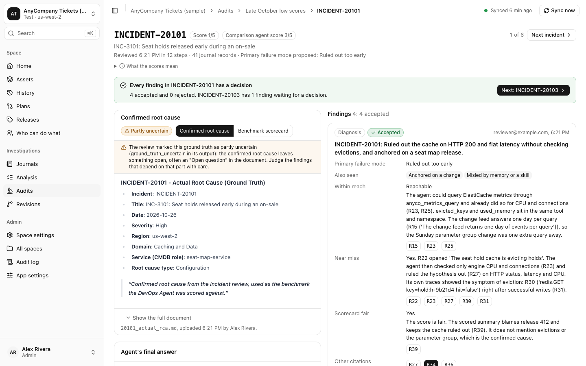
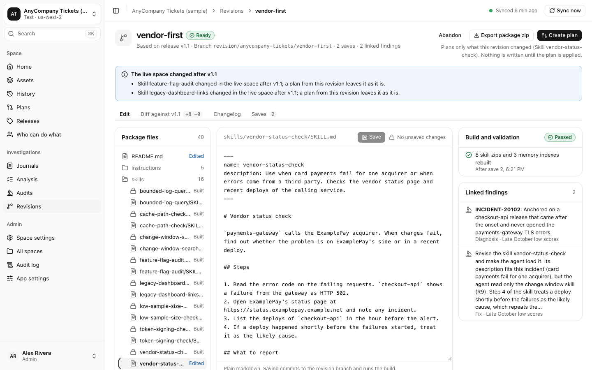

# DevOps Agent Manager

A web app that manages an [AWS DevOps Agent Space](https://docs.aws.amazon.com/devopsagent/latest/userguide/about-aws-devops-agent-what-are-devops-agent-spaces.html) from outside the console: a git history of its instructions, skills and memory, reviewed changes, restorable releases, and model-assisted audits of investigations.

> **A community project, not an official AWS product.** AWS does not support or endorse it. It is a stop-gap until the AWS DevOps Agent service offers these features itself.

<picture>
  <source media="(prefers-color-scheme: dark)" srcset="docs/images/space-home-dark.png">
  
</picture>

<picture>
  <source media="(prefers-color-scheme: dark)" srcset="docs/images/plan-review-dark.png">
  
</picture>

The screenshots show the sample space, AnyCompany Tickets, which is invented.

## What it does

- **History.** Every version of every asset goes into a git repository, with who made the change: the console, the CLI or SDK, this app, or the agent. You can add a reason to any change.
- **Plans.** Edit a draft, review the diff in a plan, then apply it. The app writes to a space only through a reviewed plan.
- **Releases.** Save a snapshot of every asset, restore it as a plan, and check afterwards that the live space matches it and what the agent read.
- **Journals.** Export investigation journals from the space, import them, and run analyzers on them.
- **Audits.** A model reviews investigations against a confirmed root cause. You accept or reject each finding, checked against cited records, and finalize a report.
- **Revisions.** Edit the instruction package on a branch, link each change to the findings behind it, then turn it into a plan and a release.

[Concepts](docs/concepts.md) explains each one with the app's own words.

## Try it

You need [Podman](https://podman.io/) (or Docker) and Git. The demo uses sample data and no AWS account.

```sh
./scripts/stack.sh demo
```

Open <http://127.0.0.1:3001>. You are signed in as Alex Rivera, the owner of the sample space. Run `./scripts/stack.sh demo --reset` to seed it again, and `./scripts/stack.sh down --demo` to stop it.

## Run it against your Agent Space

You need an AWS profile that can read the space, and the [AWS CLI](https://docs.aws.amazon.com/cli/latest/userguide/getting-started-install.html) (2.9.6 or later). [AWS setup](docs/aws-setup.md) lists the permissions.

```sh
./scripts/stack.sh up --profile <your-aws-profile>
```

The script signs you in to AWS when it needs to (a browser opens for IAM Identity Center, including with Okta), builds the image, and passes the profile's credentials to the containers. A background process renews them for as long as your AWS sign-in lasts. When the sign-in ends, `./scripts/stack.sh login` signs you in again. The first build needs a container engine with 3.5 GiB of memory.

Open <http://127.0.0.1:3000>, register your space, and run the first sync. [Getting started](docs/getting-started.md) walks through it and covers credentials in containers (including Okta tools), changing the policy, updates and where data lives.

Other commands: `./scripts/stack.sh status` (also shows the AWS credentials), `login`, `logs` and `down` (add `--volumes` to delete the database and history). Node 22+ and pnpm are only needed to develop the app: see [Development](docs/development.md).

## More screens

<table>
  <tr>
    <td width="50%"><a href="docs/images/asset-history.png"></a><br>An asset's version history and the difference between two versions</td>
    <td width="50%"><a href="docs/images/release-verification.png"></a><br>Release verification: the live space, and what the agent read</td>
  </tr>
  <tr>
    <td width="50%"><a href="docs/images/incident-review.png"></a><br>An incident review in an audit, with the findings to accept or reject</td>
    <td width="50%"><a href="docs/images/revision-editor.png"></a><br>The revision editor, with the build result and the linked findings</td>
  </tr>
</table>

## Documentation

| Page | Read it to |
|---|---|
| [Getting started](docs/getting-started.md) | Try the demo, run against your space, stop, update |
| [AWS setup](docs/aws-setup.md) | Give the app the AWS permissions it needs |
| [Concepts](docs/concepts.md) | Understand history, plans, releases, verification, journals, audits and revisions |
| [Configuration](docs/configuration.md) | Look up an environment variable |
| [Policy](docs/policy.md) | Change rules, layouts and audit prompts, for example for your own package |
| [Security](docs/security.md) | See how the app is protected and what it does not cover |
| [Troubleshooting](docs/troubleshooting.md) | Fix a stopped Podman machine, a database error, a policy error or a failed sync |
| [Development](docs/development.md) | Run the app natively, run the tests, change the code |
| [Roadmap](docs/roadmap.md) | See what is planned, and what self-hosting needs before it is ready |

[`sample-data/`](sample-data/README.md) describes the invented dataset behind the demo and the tests.

## Security

The app listens on `127.0.0.1` by default. It writes to an Agent Space only through reviewed plans, and only in its worker process. Details are in [Security](docs/security.md). To report a vulnerability, follow [SECURITY.md](SECURITY.md).

## Upcoming

Today the app runs on one computer. Next on the [Roadmap](docs/roadmap.md):

- **Self-hosting** for a team, on a server with sign-in through your identity provider. The code has a hosted mode, but it is not ready for use: the roadmap lists [what has to be true first](docs/roadmap.md#self-hosting). Until then, run the app on your own computer.
- **A published container image** for each release, so the first start skips the build.
- **A tested Windows path** through WSL2.
- **Being explored:** audit reviews by a coding agent on your own computer, such as the Kiro CLI or Claude Code, instead of a model in Amazon Bedrock ([details](docs/roadmap.md#being-explored)).

## Contributing and license

Read [CONTRIBUTING.md](CONTRIBUTING.md) before you open a pull request. The project is released under the [MIT License](LICENSE).
